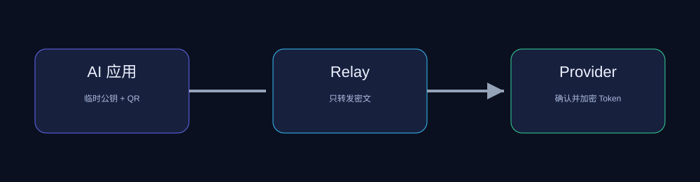

**English** | [简体中文](README.zh-CN.md)


# TokenQR

An open, client-first protocol for handing an AI provider token from the user's browser to a local app — by scanning a QR code instead of copy-pasting a secret.

**TokenQR turns "copy this API key into that app" into a one-time, end-to-end-encrypted authorization the user can see, understand, and limit.**

> **Status: POC closed (2026-09-29).** The minimal authorization loop is implemented and demonstrable. Open roadmap items are optional extensions, not part of the POC. No further development is planned unless the project's inputs or goals change.



## Why it exists

Getting a token into an AI app still means copying a secret out of a provider console, pasting it through clipboards, chat apps and screenshots, and hoping nobody sees it. The user also has no clear answer to "which app is using my token, for what, and for how long?"

TokenQR makes that an explicit authorization action:

1. the app says who it is and why it needs a token;
2. the user picks a credential and models on their own provider page;
3. the user confirms the validity period and the policy intent;
4. the token is encrypted to the requesting app's ephemeral public key;
5. the relay only forwards ciphertext — it never sees the token.

It is not another token cloud and it does not lock anyone into one vendor. It is an open authorization channel that local apps, open-source tools, desktop software and optional gateways can share.

## What it can do now

- **Two-sided POC UI** (`tokenqr.html`): a *computer app* tab that requests a token and a *provider* tab that authorizes it.
- **Multiple provider profiles** kept in the browser's `localStorage`, with `/models` auto-fetch and manual fallback.
- **One-time QR codes** generated in the browser and scanned with any camera supported by `BarcodeDetector` (or pasted as text).
- **End-to-end encryption**: P-256 ECDH key agreement with AES-256-GCM; the QR contains only the relay endpoint, the ephemeral public key, app metadata and an expiry.
- **Explicit consent screen**: app name, reason, validity, authorized provider, allowed models and displayed rate/quota intent.
- **Three API shapes** after authorization: OpenAI Chat Completions, OpenAI Responses, and Anthropic Messages; a minimal chat box sends a request with the authorized credential.
- **Relay-free reverse mode** (`reverse.html`): the provider encrypts a config with a long memorable password (PBKDF2-SHA-256, 250k iterations, AES-256-GCM), shows a QR (`TQD1`), and the receiver decrypts it locally with the same password.
- **Local relay** (`server.py`): a standard-library mailbox with `POST` / one-shot `GET` / `DELETE` on `/relay/<id>`, plus CORS.
- **Optional gateway** (`gateway/gateway.py`): creates app-specific `tqr_live_…` credentials, enforces model allowlists, expiry, revocation, RPM and token budgets, proxies streaming responses, and exposes `/v1/models` plus an admin usage view.

## Quick start

You need Python 3 and a browser. Nothing to install for the POC.

Terminal 1 — local relay:

```bash
python3 server.py
```

Terminal 2 — static pages:

```bash
python3 -m http.server 8080
```

Open <http://localhost:8080/tokenqr.html>. Use the **computer app** tab to generate a QR code, then the **provider** tab to scan or paste it, choose a configured provider, and confirm. The relay listens on `http://localhost:8765/relay` by default; the field in the UI is editable.

For the relay-free flow, open <http://localhost:8080/reverse.html>, enter a provider config as JSON in the provider tab, set a long password, and scan the resulting QR in the receiver tab.

## Architecture

Three small pieces, no framework and no build step:

```text
tokenqr.html        single-page POC: computer app + provider tabs, QR, WebCrypto
reverse.html        relay-free reverse authorization (password-encrypted QR)
server.py           local relay: one-shot message mailbox on :8765
gateway/
  gateway.py        optional policy-enforcing proxy on :8787
  README.md         gateway boundary and LiteLLM direction
vendor/qrcode.js    prebuilt QR encoder used by both pages
docs/
  protocol.md       QR payload, encrypted payload, relay contract, policy semantics
  project-status.md status and evidence
```

The flow: the computer app generates an ephemeral P-256 key pair and a random relay endpoint, and puts the public key and metadata into a `TQR1` QR payload. The provider scans it, encrypts the chosen credential to that public key, and `POST`s the ciphertext to the relay endpoint. The computer app polls the same endpoint once, receives the ciphertext, decrypts it locally, and can then call the provider API directly. The relay holds one opaque message and forgets it after the read.

The optional gateway sits between the app and the upstream provider. Instead of handing over the provider's root token, the provider page asks the gateway for a scoped credential; the gateway stores only its hash and enforces the allowlist, expiry and limits on every request.

## Development

The pages are self-contained HTML with inline JavaScript; `vendor/qrcode.js` is a prebuilt browser bundle and does not need rebuilding to run the POC.

```bash
# optional: dependencies used to regenerate the QR vendor bundle
npm install

# syntax-check the Python services
python3 -m py_compile server.py gateway/gateway.py
```

There is no test suite or linter configured. Check a change by loading both pages and running the full loop against the local relay; additionally run `git diff --check` and the `node --check` syntax check on any inline script you edit.

To run the optional gateway:

```bash
TOKENQR_UPSTREAM_URL=https://api.openai.com/v1 \
TOKENQR_UPSTREAM_TOKEN=sk-... \
TOKENQR_ADMIN_TOKEN=... \
python3 gateway/gateway.py
```

It listens on `http://localhost:8787` by default (`TOKENQR_PUBLIC_URL` sets the base URL it hands back, `TOKENQR_DATA` the state file, ignored by git). Configure it in the provider page's optional Gateway field, then choose **Create restricted token** instead of sending the raw token.

## Security boundary

TokenQR removes copy-paste and chat-app leakage from the authorization path. It does not protect a compromised computer, a malicious browser extension, a malicious provider page, or an app that already holds the decrypted token. Whether a provider actually revokes or expires a token remains the provider's decision, and rate/quota/model limits are intent unless a provider or gateway enforces them.

Do not use long-lived production tokens in public demos. See [SECURITY.md](SECURITY.md) and the [protocol draft](docs/protocol.md).

## Contributing

Issues and pull requests are welcome — protocol clarity, relay adapters, provider adapters and security review especially. Read [CONTRIBUTING.md](CONTRIBUTING.md) first. The project is MIT-licensed and aims to make token authorization open infrastructure any AI app can use.

## Roadmap

Implemented:

- [x] Single-page web POC with computer and provider tabs
- [x] Multiple provider profiles and model selection
- [x] Local relay with one-shot delivery
- [x] End-to-end encrypted authorization (P-256 ECDH + AES-256-GCM)
- [x] Relay-free reverse authorization (`TQD1`)
- [x] Optional gateway with scoped credentials, limits and revocation

Planned, optional:

- [ ] Public relay adapter
- [ ] Provider model-list cache and editing
- [ ] LiteLLM-style gateway adapter
- [ ] Independent protocol implementations and interoperability tests

The longer-term vision is a small, well-specified authorization channel: any local app can ask, any provider page can grant, any relay can carry the ciphertext, and an optional gateway can turn the grant into enforceable limits. Everything beyond the closed POC loop is an extension, not a promise.

## License

[MIT](LICENSE) © TokenQR contributors.
