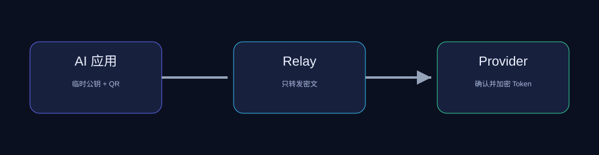

[English](README.md) | **简体中文**


# TokenQR

一个开放的、客户端优先的协议：用户在自己的浏览器里确认授权，AI Provider 的 Token 经一次性二维码交给本地应用，而不是被复制粘贴。

**TokenQR 把“把这个 API Key 粘进那个应用”变成一次用户看得见、看得懂、可以限制的一次性端到端加密授权。**

> **状态：POC 已闭环（2026-09-29）。** 最小授权链路已经实现并可演示。路线图中未勾选的条目属于可选扩展，不属于 POC 范围。除非项目输入或目标发生变化，不再计划继续开发。



## 为什么需要 TokenQR

把 Token 交给 AI 应用，至今仍然是从 Provider 控制台复制 Secret，经过剪贴板、聊天软件和截图粘贴到另一个应用，并祈祷中途没人看到。用户也无法清楚回答：“哪个应用正在用我的 Token、用来做什么、用到什么时候？”

TokenQR 把这件事变成一个明确的授权动作：

1. 应用说明自己是谁、为什么需要 Token；
2. 用户在自己的 Provider 页面选择凭据和模型；
3. 用户确认授权期限和策略意图；
4. Token 用请求方的一次性公钥加密；
5. Relay 只转发密文，永远看不到 Token。

它不是另一个 Token 云服务，也不会把任何人锁在某个供应商里。它是一条开放的授权通道，本地应用、开源工具、桌面软件和可选 Gateway 都可以共用。

## 现在能做什么

- **双端 POC 界面**（`tokenqr.html`）：*电脑端应用* Tab 发起请求，*Provider* Tab 完成授权。
- **多套 Provider 配置**保存在浏览器 `localStorage` 中，支持 `/models` 自动拉取和手动填写兜底。
- **一次性二维码**在浏览器内生成，可用支持 `BarcodeDetector` 的相机扫描，也可以直接粘贴文本。
- **端到端加密**：P-256 ECDH 协商密钥，AES-256-GCM 加密；二维码里只有 Relay 地址、一次性公钥、应用信息和过期时间。
- **明确的确认页**：应用名、使用理由、有效期、授权 Provider、允许的模型，以及展示用的限流/限量意图。
- **三种 API 形式**：授权后可使用 OpenAI Chat Completions、OpenAI Responses 和 Anthropic Messages；内置一个极简聊天框，用授权凭据发出请求。
- **无需 Relay 的反向模式**（`reverse.html`）：Provider 用一段好记的长密码加密配置（PBKDF2-SHA-256，25 万次迭代，AES-256-GCM），生成 `TQD1` 二维码，接收方用同一密码在本地解密。
- **本地 Relay**（`server.py`）：标准库实现的一次性消息邮箱，`/relay/<id>` 支持 `POST`、读取一次即删除的 `GET` 和 `DELETE`，并带 CORS。
- **可选 Gateway**（`gateway/gateway.py`）：签发应用专用的 `tqr_live_…` 凭据，执行模型白名单、过期、撤销、RPM 和 Token 预算限制，透传流式响应，并提供 `/v1/models` 和管理端用量视图。

## 快速开始

只需要 Python 3 和一个浏览器，POC 本身没有需要安装的东西。

终端一 —— 本地 Relay：

```bash
python3 server.py
```

终端二 —— 静态页面：

```bash
python3 -m http.server 8080
```

打开 <http://localhost:8080/tokenqr.html>。在**电脑端应用** Tab 生成二维码，再到 **Provider** Tab 扫描或粘贴，选择已配置的 Provider 并确认。Relay 默认监听 `http://localhost:8765/relay`，界面里的地址可以修改。

想走无 Relay 流程，打开 <http://localhost:8080/reverse.html>，在 Provider 端以 JSON 填入 Provider 配置、设置一段长密码，再用接收方 Tab 扫描生成的二维码。

## 架构

三个小部件，没有框架，也没有构建步骤：

```text
tokenqr.html        POC 单页：电脑端 + Provider 双 Tab、二维码、WebCrypto
reverse.html        无 Relay 的反向授权（密码加密二维码）
server.py           本地 Relay：:8765 上的一次性消息邮箱
gateway/
  gateway.py        可选的政策执行代理，监听 :8787
  README.md         Gateway 边界与 LiteLLM 方向
vendor/qrcode.js    预构建的二维码编码器，两个页面共用
docs/
  protocol.md       二维码载荷、加密载荷、Relay 契约、策略语义
  project-status.md 状态与证据
```

流程是这样的：电脑端应用生成一对一次性 P-256 密钥和一个随机 Relay 地址，把公钥和元数据放进 `TQR1` 二维码。Provider 扫描后，把选中的凭据加密到这把公钥上，再 `POST` 密文到 Relay 地址。电脑端应用轮询同一个地址，只读取一次，拿到密文后在本地解密，之后就可以直接调用 Provider API。Relay 只保存一条不透明消息，被读取后即丢弃。

可选 Gateway 位于应用和上游 Provider 之间。Provider 页面不再交出上游主 Token，而是向 Gateway 申请一枚受限凭据；Gateway 只保存它的哈希，并在每次请求时执行白名单、过期和限额。

## 开发

页面都是内联 JavaScript 的自包含 HTML；`vendor/qrcode.js` 是预构建的浏览器 bundle，运行 POC 不需要重新构建。

```bash
# 可选：重新生成二维码 vendor bundle 时才需要这些依赖
npm install

# 对 Python 服务做语法检查
python3 -m py_compile server.py gateway/gateway.py
```

项目没有配置测试套件或 linter。验证改动的方式是加载两个页面，对本地 Relay 跑完整链路；另外对修改过的内联脚本执行 `node --check` 语法检查，并运行 `git diff --check`。

运行可选 Gateway：

```bash
TOKENQR_UPSTREAM_URL=https://api.openai.com/v1 \
TOKENQR_UPSTREAM_TOKEN=sk-... \
TOKENQR_ADMIN_TOKEN=... \
python3 gateway/gateway.py
```

它默认监听 `http://localhost:8787`（`TOKENQR_PUBLIC_URL` 设置对外返回的地址，`TOKENQR_DATA` 设置状态文件，已被 git 忽略）。在 Provider 页面的可选 Gateway 地址里填入它，然后选择**创建受限 Token**，而不是直接发送原始 Token。

## 安全边界

TokenQR 消除的是授权链路上的复制粘贴和聊天软件泄露。它不保护已经被攻破的电脑、恶意浏览器扩展、恶意 Provider 页面，也不保护已经拿到解密后 Token 的应用。Provider 是否真的撤销或过期 Token 仍由 Provider 决定；限流、限量、模型限制在没有 Provider 或 Gateway 强制执行时只是授权意图。

不要在公开演示中使用长期生产 Token。详见 [SECURITY.md](SECURITY.md) 和[协议草案](docs/protocol.md)。

## 参与贡献

欢迎提交 Issue 和 Pull Request，尤其是协议清晰度、Relay 适配器、Provider 适配器和安全审查。请先阅读 [CONTRIBUTING.md](CONTRIBUTING.md)。项目采用 MIT License，目标是让 Token 授权成为所有 AI 应用都能使用的开放基础设施。

## 路线图

已实现：

- [x] 含电脑端与 Provider 双 Tab 的单页 POC
- [x] 多 Provider 配置与模型选择
- [x] 一次性投递的本地 Relay
- [x] 端到端加密授权（P-256 ECDH + AES-256-GCM）
- [x] 无 Relay 的反向授权（`TQD1`）
- [x] 带受限凭据、限额和撤销的可选 Gateway

计划中（可选）：

- [ ] 公共 Relay 适配器
- [ ] Provider 模型列表缓存与编辑
- [ ] LiteLLM 风格的 Gateway 适配器
- [ ] 独立协议实现与互操作测试

更长远的目标是一条小而明确的授权通道：任何本地应用都能发起请求，任何 Provider 页面都能授权，任何 Relay 都能搬运密文，可选 Gateway 则把授权变成可强制执行的限额。POC 闭环之外的一切都是扩展，而不是承诺。

## License

[MIT](LICENSE) © TokenQR contributors。
